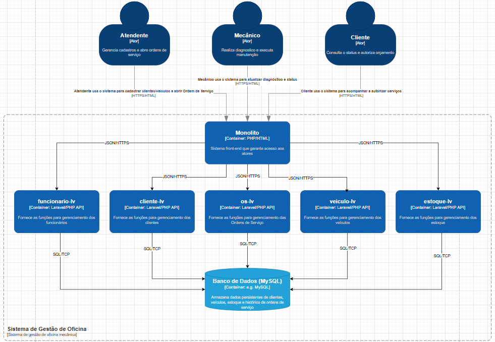

# Sistema de Gestão de Oficina Mecânica (Microserviços)
### MVP - Tech Challenge

Sistema projetado para a solução operacional de oficinas mecânicas, focando na rastreabilidade total do ciclo de vida de uma manutenção, desde a entrada do veículo até a entrega final com disparos automáticos de e-mail.

### Arquitetura e Tecnologias
A solução foi decomposta em contêineres independentes para garantir alta coesão e isolamento de domínios (Bounded Contexts).
* **Linguagem:** PHP 8.4 (Laravel Framework nas APIs) e PHP Puro (Front-end)
* **Banco de Dados:** MySQL 8.0 (Persistência) e SQLite (Testes)
* **Orquestração:** Docker, Docker Compose e Kubernetes (K8s)
* **Mensageria & Notificações:** SMTP interceptado via MailHog
* **Padrões:** DDD (Domain Driven Design), Arquitetura Hexagonal, Clean Code.

### Ecossistema de Microsserviços e Front-end: 
- **Monólito (Front-end):** Interface de usuário centralizada em PHP que consome o ecossistema de APIs via JWT.
- **Cliente-lv:** Gestão de cadastro de clientes.
- **Veiculo-lv:** Gestão de frota e vínculos com clientes.
- **Funcionario-lv:** Gestão de colaboradores e autenticação JWT.
- **Estoque-lv:** Controle de peças e insumos.
- **Os-lv:** Core Domain - Gestão de Ordens de Serviço, transições de status e disparos de e-mail ao cliente.

## Saga das ordens de serviço

O fluxo OS/Estoque usa coreografia assíncrona via RabbitMQ, sem coordenador
central. `Os-lv` grava a mudança local e o evento
`OSStockAdjustmentRequested` na mesma transação SQL (transactional outbox). O
publicador entrega o evento persistente ao exchange `mws.saga`; `Estoque-lv`
consome a fila `estoque.stock-adjustments`, valida o saldo e aplica a alteração
em uma transação no seu próprio banco. Em seguida grava o evento
`stock.adjustment.succeeded` ou `stock.adjustment.failed` na própria outbox.
`Os-lv` consome o resultado pela fila `os.stock-results` e conclui ou compensa
a operação.

Os eventos carregam `saga_id`, `event_id`, `operation_id` e `correlation_id`.
Cada serviço mantém uma inbox com unicidade por `event_id`; a operação de estoque
também usa uma chave idempotente persistida em `stock_operations`. O publicador
reenvia eventos pendentes; consumidores repetidos não repetem efeitos. Mensagens
com falhas transitórias aguardam cinco segundos antes de até cinco tentativas e
depois seguem para a fila `mws.saga.dead`.

Se a reserva inicial falhar, a OS é marcada como cancelada e seus itens ficam
preservados para auditoria. Se uma edição, análise, cancelamento, rejeição ou
exclusão não conseguir concluir o ajuste de estoque, `Os-lv` restaura o snapshot
local da operação. Uma exclusão só remove a OS depois da confirmação da devolução
ao estoque. A API de criação responde com o recurso criado e `saga_status` igual
a `PENDENTE`; consulte `GET /api/os/{id}/saga` até a conclusão ou compensação.
Transições operacionais ficam bloqueadas enquanto a Saga estiver pendente.

Essa escolha separa os bounded contexts e tolera indisponibilidade temporária do
broker por meio das outboxes, com consistência eventual em vez de rollback ACID
distribuído. As consultas de referência continuam síncronas via REST; alterações
de saldo de estoque ligadas à OS trafegam por eventos.

No Docker Compose, RabbitMQ e os dois workers são iniciados junto com a aplicação
por `docker compose up -d --build`. O painel de administração local fica em
`http://localhost:15672`; use `RABBITMQ_USER` e `RABBITMQ_PASSWORD` do `.env`.
No Kubernetes, aplique primeiro o Secret `mws-rabbitmq-secret` criado a partir
de `k8s/mws-rabbitmq-secret.yaml.example`, depois `k8s/rabbitmq.yaml` e os
Deployments `k8s/estoque-saga-worker.yaml` e `k8s/os-saga-worker.yaml`.

## Banco NoSQL do Cliente

`Cliente-lv` mantém os dados cadastrais no MySQL isolado do serviço e usa o
MongoDB para a coleção documental `cliente_audit_events`. Criação, alteração e
exclusão geram eventos com os campos alterados, data, ID do cliente e correlação;
valores pessoais não são copiados para o documento de auditoria. Consulte pelo
endpoint autenticado `GET /api/clientes/{id}/auditoria`. Falhas temporárias do
MongoDB são registradas sem desfazer a gravação já confirmada no MySQL.

O Compose inicia um MongoDB persistente junto do Cliente. No Kubernetes, ajuste
a senha em `k8s/mws-mongodb-secret.yaml.example` e use a mesma senha na URI
`MONGODB_URI` do Secret do Cliente. O CI testa gravação e leitura em um MongoDB
real.

## Como executar o projeto
### Opção 1: Ambiente Local (Docker Compose)
Copie `docker-compose.env.example` para `.env`, substitua os segredos e mantenha `MYSQL_ROOT_PASSWORD` compatível com o volume MySQL existente. Depois execute na raiz: <br>
`docker compose up -d --build`
  
### Configurar os Bancos de Dados e Seeders
O setup cria os schemas isolados, executa as migrations e, quando há dados legados em `mws_db`, copia os dados preservando IDs e snapshots. Faça backup e pare gravações no banco legado antes do backfill; o script recusa destinos não vazios. Em ambiente novo, cria o usuário inicial. Execute: <br>
`chmod +x setup.sh` <br>
`./setup.sh` <br>

## Como executar o projeto
### Opção 2: Ambiente Clusterizado (Kubernetes)
Para deploy no cluster Kubernetes (Minikube ou EKS), provisione primeiro um schema e usuário por serviço no MySQL/RDS, preencha e aplique `k8s/mws-service-secrets.yaml.example` com segredos reais e ajuste o `DB_HOST` em `k8s/mws-configmap.yaml`. Faça backup e backfill dos dados antes de liberar tráfego. Depois aplique os manifests da pasta k8s/ <br>
`kubectl apply -f k8s/` <br>

Para acessar o painel de interceptação de e-mails de desenvolvimento, redirecione a porta do MailHog:
`kubectl port-forward svc/mailhog 8025:8025`
  
### Credenciais de acesso
Para testar os endpoints que exigem autenticação: <br>
`Usuário: admin` <br>
`Senha: admin123` <br>

## Testes Automatizados
Os testes usam SQLite em memória para não acessar os bancos dos serviços. Execute todos com:

```bash
for service in cliente-lv-api veiculo-lv-api estoque-lv-api funcionario-lv-api os-lv-api; do
  docker compose exec -T -e DB_CONNECTION=sqlite -e DB_DATABASE=:memory: -e DB_URL= "$service" php artisan test || break
done
```

Para testar apenas um serviço, use o mesmo comando substituindo `$service` pelo nome do container.

O CI executa os testes dos cinco microsserviços com PHP 8.4 e PCOV e falha se
qualquer serviço ficar abaixo de 80% de cobertura de statements. Cada serviço gera
um relatório Clover; Pint verifica estilo e PHPStan nível 1 faz análise estática.
O cenário BDD do ciclo de OS roda em uma etapa própria do pipeline e está em
`Microservicos-lv/php84/Os-lv/tests/Feature/ordem-servico.feature` e sua execução
está em `OrdemServicoControllerTest`.

## Documentação e APIs
A documentação completa, incluindo o Event Storming, Mapa de Contexto e Linguagem Ubíqua, pode ser acessada através do link abaixo:
[Estratégia de comunicação entre microsserviços](./docs/estrategia-comunicacao-microsservicos.md)
[Acesse a Documentação no Notion](https://www.notion.so/TECH-CHALLENGE-338b36cb511a80cb9c12d5c70c5682c7?source=copy_link)
[Endpoints (Postman)] (https://gustavo-5520387.postman.co/workspace/Gustavo's-
Workspace~e01e23b1-b0c9-4148-8bea-f931ea6d3628/collection/45952571-cfa04a96-
15fd-4662-b65d-0e6b27d75d80?action=share&creator=45952571)

## Segurança e Vulnerabilidades
Realizamos scans de segurança utilizando o composer audit
  - Status Atual: 0 vulnerabilidades críticas encontradas no código de produção

## Observabilidade

O projeto instrumenta o Monólito e as cinco APIs com Datadog APM, logs JSON em
`stderr`, `X-Correlation-ID`, métricas DogStatsD e healthchecks. Para Kubernetes,
há requests/limits e probes de readiness/liveness; o Agent coleta APM, logs e
métricas de CPU/memória. Os recursos de dashboard e monitores ficam em
`observability/`.

No Docker Compose, copie `docker-compose.env.example` para `.env`, configure
`DD_API_KEY` e suba o Agent opcional junto dos serviços:

```bash
DD_AGENT_HOST=datadog-agent docker compose --profile observability up -d --build
```

Preencha `DD_API_KEY`, `DD_APP_KEY` e `DD_SITE` no `.env` ignorado pelo Git. O
provisionador lê essas variáveis do arquivo sem imprimi-las:

```bash
python3 observability/provision-datadog.py
```

Depois de provisionar os monitores, associe-os ao canal de notificação usado
pela equipe (por exemplo, Slack ou PagerDuty) na conta Datadog.

No Kubernetes, veja [o guia de observabilidade](./k8s/README.md#datadog-observabilidade).

## CI/CD

O CI roda testes, BDD, cobertura e qualidade. Os workflows independentes
`cd-cliente.yml`, `cd-veiculo.yml`, `cd-estoque.yml`, `cd-funcionario.yml`,
`cd-os.yml` e `cd-monolito.yml` são disparados quando `Laravel CI` termina com
sucesso na branch `main`. Cada workflow recebe o SHA exato aprovado, constrói e
publica somente a imagem do seu serviço no Amazon ECR, atualiza seus deployments
no EKS e aguarda o rollout. O fluxo comum está em `cd-service.yml`; não há mais
um workflow agregado nem um segundo workflow de deploy do Monólito.

## Autor
  - Gustavo Pirolo - Cientista da Computação & Trainee Software Development
  - Apelido do Servidor: Gustavo Pirolo - RM371637 
